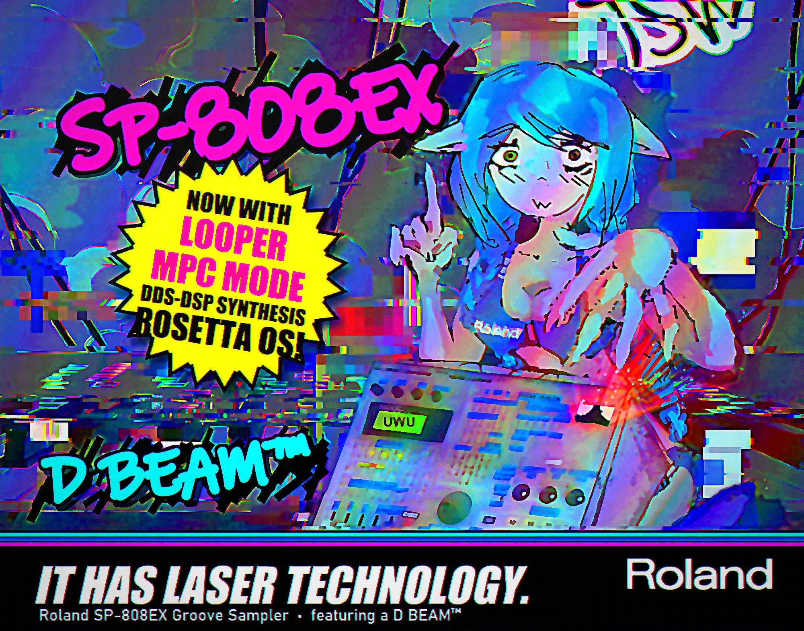

<p align="center"></p>

<p align="center"><a href="https://discord.gg/R3CQkFdRtf"></a></p>

# SP-808 Rosetta Looper OS

> **NEW: plain CF cards instead of the Zip (October 2026).** A cheap IDE-to-CF adapter (tested: StarTech
> 35BAYCF2IDE, card in the master slot) replaces the dying Iomega Zip drive. First hardware test on an SP-808 with
> Roland's stock OS 1.05 + the CF patch: it boots, samples, saves, keeps everything over a power-cycle, and is
> **faster than a ZuluIDE**. The boot ROM already
> drives ATA cards; the OS only stalled on two Zip-only commands (about a second each, every disk check), and
> `tools/cf_patch.py` skips them on CF (a Zip behaves as before). It is also an option in Rosetta Patcher ("CF card
> support (beta)"), for Rosetta or for Roland's stock OS. **No Zip drive at all?** It installs over MIDI too: see
> [CF cards](#cf-cards-no-zip-needed). Still untested on hardware: Rosetta + CF and the SP-808EX OS + CF. Reports
> welcome on [Discord](https://discord.gg/R3CQkFdRtf).

> **Runs on real hardware.** Custom firmware boots on a real Roland SP-808(EX) and installs straight from a Zip or
> ZuluIDE SD card: Roland-chan boot animation, own home menu, MPC-style pad sampling, and **KEYS: an 8-voice pitched
> sampler running as our own program in the FX DSP**, on top of the 4 stock voices, with **DDS-DSP** oscillators
> (saw / pulse / triangle / detuned unison) layered on every voice. See [Status](#status-2026-10-15).

> **Preview, work in progress (October 2026).** This is published as-is so people can see the menus, the tooling and
> how far the reverse engineering got, and expand it if they want. KEYS and DDS-DSP (v1.81) are confirmed on a real
> unit; the old looper (v0.9b) is on the card but not tested yet, and Looper v2 is planned (`LOOPER_DESIGN.md`). The code is working-state, not cleaned up: one patch script
> per version, long notes, no packaging. Start with [Use](#use), `NOTES.md` and `tools/build_v10.py`.
> The disk side (takes to/from WAV, R-DAC codec, ZuluIDE tool) lives in
> [sp-808-disk-studio](https://github.com/yuyoi/sp-808-disk-studio).
> Questions, hardware reports and ideas: **[Discord](https://discord.gg/R3CQkFdRtf)**.

Goal: turn the Roland SP-808 Groove Sampler into a **guitar looper / MPC-style sampler**. The groove/song UI comes
out, the sampler stays, and three modes get their own buttons: **MPC** (pad sampling), **Looper** (layers, overdub,
footswitch + MIDI) and **Keyboard** (one sound pitched across the 16 pads and a MIDI keyboard). Stretch goal: Doom.

Part of the Rosetta family, after [Rosetta ROM](https://github.com/yuyoi/Rompler-RosettaRom) (D-110 sample swap and OS mod).

## What works

- **Decode Roland's update** (`SP808v1050.zip`, 8 SMF files of SysEx) into the plain OS image: 7-bit packed data,
  no compression, no encryption. `decode_upd.py` is bit-exact.
- **Install from disk:** the OS updates itself from `SP808.PRG` on a FAT12/16 Zip disk. The only checks are a magic
  byte, a tag and a header copy, **no checksum**. `fat_add.py` puts the file on a Zip / ZuluIDE disk image.
- **Reverse-engineered H8S OS:** homemade disassembler, xref builder and a small label assembler. UI engine (screen
  table, key groups), LCD/boot-ROM API, buttons, faders, knobs, D-Beam and footswitch ADC channels are mapped in the docs.
- **Roland-chan boot animation** (replaces the S-P-8-0-8 slide and the second Groove Sampler splash): she slides up,
  blinks, smiles, then "JSW OS" and "ROSETTA" type in.
- **Own home menu** (SAMPLE = MPC, SONG = Looper, SYSTEM = Keyboard, SHIFT+SYSTEM = stock system menu). The VALUE
  dial and the cursor keys both work in it.
- **MPC mode** (MPC page: Pad / Rec / Start):
  - **CLASSIC (default), like a real MPC:** hit a pad to select it (the page shows its number and whether it's used),
    then ENTER, SAMPLE or PAD SAMPLING records into it.
  - Any pad stops the take.
  - On the result screen: ENTER keeps the take, another pad moves it there (the selected pad goes back to how it was).
  - Other modes: NEXT FREE (first empty pad), TAP / HOLD (SHIFT+pad records into that pad). Start INSTANT or WAIT
    SIGNAL.
- **KEYS mode (v1.72, works on hardware):** hit any pad from any bank (PAD BANK or the dial picks the bank) and it is
  captured into the FX DSP's delay RAM, then played pitched across the 16 pads and a MIDI keyboard:
  - 8 voices of our own DSP1 program **plus** the 4 stock disk voices: pads and tracks keep playing through KEYS.
  - Live pitch per note: each voice reads the RAM with its own fractional phase and interpolates (`keysdsp.py`).
  - MIDI keyboard C2-C7 (C4 = pad 8), velocity, release on the dial, SHIFT+EXIT or PAD BANK = pick another sample.
  - **S-EDIT** page: resonant low-pass (knob A cutoff, B resonance), attack (knob C), release, reverse, loop
    (sustain while held, crossfaded voice handoff), THRU on/off.
  - The 7-segment line shows **POLY n**, the voices sounding right now.
- **DDS-DSP page (v1.8-v1.81, works on hardware):** every KEYS voice also runs its own oscillators in the DSP, mixed
  with the sample, each with its own level: SAMPLE, SAW, SQUARE + WIDTH (pulse width), TRI, SAW2 (a second saw,
  DETUNE in 1/16 semitones), OCT. SAMPLE 0 =
  pure synth, notes hold while the key is held. The oscillator is a raw 24-bit phase (DDS); pulse and triangle are
  shaped from it with saturation and abs, all in the same DSP instructions per voice.
- **Built and emulator-tested (v1.9-v1.97); the menus and LAB pages are confirmed on the unit (v1.95-v1.96),
  the rest waits for the hardware test:**
  - Every text page in a **Classic Mac** style: window, pinstriped title, scrolling list, ENTER = a full-screen
    submode menu with full names.
  - **DDS-DSP** tabs: OSCILLATORS, SAMPLE ATTACK (LA: the sample's attack, then the oscillators), ENVELOPES (decay,
    sustain, filter envelope), MODULATION (LFO: vibrato, tremolo, filter, 4 waves, delay), ARPEGGIATOR (up / down /
    up+down / random, 60-240 BPM, gate, 1-3 octaves), VOICE MODE (poly, mono with glide, unison).
  - **ROUTING** tile: Roland's own mixer with presets (DRY, INPUT FX, LOOP FX, MASTER FX, REC FX), the 16 FX
    locations, levels, pans, FX / AUX sends.
  - **MFX** tile: the three FX insert slots DSP0 has (Roland uses one), each placeable at 14 mix points, with knobs /
    D-Beam / footswitch mapping. Each slot picks an effect (v1.97): **FILTER** (LP / BP / HP, cutoff, resonance),
    **DRIVE** (gain, tone, bit / rate crush), **DELAY** (up to 1.48 s, feedback, mix; slots on DELAY share the delay
    RAM), **MOD** (tremolo, auto-pan, ring). The knobs can drive any slot's params. Tested in the emulator, waiting
    for ears on the unit.
  - **LAB** tile (hidden hardware): live bars of all 14 analog inputs, any button's factory name, a light show over
    all 65 LEDs, the 184 unused bits of the 7-segment line (checked on the unit: no hidden icons), the input meter on the pads.
  - KEYS lights the pads of the notes that sound.

## State in one look

| part | state |
|---|---|
| decode Roland's update, build, install from disk, recovery | works on hardware |
| Roland-chan boot, home menu, MPC page, record / take-done screens, 7-seg ticker (v0.8) | works on hardware |
| KEYS: 8 + 4 voices, MIDI keyboard, velocity, S-EDIT filter / attack / release / reverse / loop, PAD BANK (v1.72) | works on hardware |
| DDS-DSP: saw / pulse + PW / triangle / detuned unison per voice, layered with the sample (v1.81) | works on hardware |
| looper: pad layers, overdub, undo / clear on PAD SAMPLING (v0.9b) | on the card since v1.8, **hw test pending** |
| DDS-DSP tabs LA / ENV, Classic Mac menus, looper stopgap keys (v1.9) | emulator-tested, not on hw yet |
| ROUTING (Roland's mixer + FX location, presets), LAB (live ADC bars, buttons, LED show), MFX (3 FX insert slots, engine, controls), held keys on the pad LEDs (v1.91) | emulator-tested; menus, LAB BUTTONS / LED SHOW / LCD ICONS / PAD VU and MFX slot select work on hardware (v1.96) |
| MFX effects per slot: FILTER / DRIVE + CRUSH / DELAY / MOD (v1.97) | slot 1 FILTER / DELAY / MOD **work on hardware**; slots 2/3 silent on the unit, being debugged |
| KEYS synth only: SAMPLE 0 plays at once, no source pad (v1.98) | emulator-tested, not on hw yet |
| H8S disassembler / xref / assembler / emulator, ESP2 DSP decoder and simulator | work, used for all of the above |

Open points for whoever picks it up:
- **Looper engine:** the song engine has no loop/cycle play at all. Pads loop seamlessly, so layers = looping pads
  (stock sampling stops all pads; that call is hooked out). Notes: `LOOPER_DESIGN.md`.
- **KEYS:** one rare hang seen once after fast chords (gone after that). Stock FX stay silent after KEYS until an FX is
  loaded again. Samples up to ~1.4 s. Resampling the keys' output isn't done.
- Voices: DSP0 (the voice engine) is full, so the 4 disk voices stay 4; extra voices live in **DSP1, the effects
  core** (Roland/Toshiba ESP2, instruction set public since The Usual Suspects' JP-8000 work). Its 128K-word
  delay RAM is ~3 s of audio: short samples only.
- Recording into a used pad skips the stock "Overwrite?", so the old wave may be orphaned (stock CLEANUP DISK).
- LCD width: 132 or 136 px (the stock logo is centred on 136).

<p align="center"></p>

## Use

You must supply Roland's **own update file** (`SP808v1050.zip`, SP-808 OS v1.05). It is Roland's copyrighted code
and is not in this repo.

<p align="center"></p>

**Easiest: Rosetta Patcher (Windows).** Download `RosettaPatcher.exe` from the
[Releases](https://github.com/yuyoi/Sp-808-rosetta-looper-OS-/releases) page and run it: no Python needed. Or, with
Python 3 (`pip install numpy pillow`), double-click
`tools/Rosetta_Patcher.bat` (or run `python tools/rosetta_patcher.py`). Pick your `SP808v1050.zip`, an output
folder and, optionally, your Zip / ZuluIDE disk image. It builds `SP808.PRG` and can put it straight into the image
(a `.bak` is made first, and the file is read back to check it). Command line:
`python -I tools/rosetta_patcher.py --upd SP808v1050.zip --out outdir [--img disk.img]`.
CF beta: add `--cf`, or `--stock --cf` with `SP808v1050.zip` or `SP808EXv1001.zip` for Roland's own OS + CF only
(the EX build is for SP-808EX units only). See [CF cards](#cf-cards-no-zip-needed).

### CF cards (no Zip needed)

1. **Card:** write an SP-808 disk image raw onto the CF card (Win32 Disk Imager / HDD Raw Copy, not a Windows
   format), or format it in the unit once the patch is in.
2. **Adapter:** a passive IDE-to-CF adapter in place of the Zip drive, card as **master**, 5 V connected.
3. **Install the CF build**, either way:
   - **From a Zip / ZuluIDE:** Rosetta Patcher with "CF card support (beta)" -> `SP808.PRG`, install as usual.
   - **Over MIDI (no Zip drive):** unzip Roland's update into `upd/`, then
     `python -I tools/rosetta_patcher.py --upd upd --out out --stock --cf` and
     `python -I tools/encode_upd.py upd out/SP808.PRG out/midi`. This makes Roland-format `SP808#1-8.MID` with the patch
     inside (checked with the boot ROM's own MIDI receiver in an emulator). Power on holding **STATUS + EFFECTS above
     fader A** ("Waiting MIDI..."), play the 8 files in order from any sequencer (or
     `python -I tools/sp808_midi.py update out/midi --midi <your MIDI out> --no-check`), answer YES to
     "Update System?". The SP-808's boot ROM takes the SP-808 (1.05) format.
4. **Check:** with Rosetta, LAB > DISK INFO shows TYPE ATA (CF/HD), the size and any error.

By hand: unzip `SP808#1.MID` .. `SP808#8.MID` into `upd/`, then:

```
pip install numpy pillow
python -I tools/decode_upd.py upd sp808_v1050_raw.bin                  # Roland update -> OS image
python -I tools/build_v10.py sp808_v1050_raw.bin build_v10             # -> build_v10/SP808.PRG
python -I tools/fat_add.py disk.img build_v10/SP808.PRG --replace      # put it on your Zip / ZuluIDE image
```

On the SP-808: power on with the disk in, answer **YES** to "Update System?", then power-cycle when it asks for
the Zip. Hold **HOLD** at power-on to force the prompt. **Back up your disk image first.**

**Recovery** (built into the boot ROM, the OS can't break it): power on holding [STATUS] + [EFFECTS] above fader A,
then play Roland's `SP808#1-8.MID` into MIDI IN.

**Legal:** this repo contains no Roland code. The build scripts patch **your own** decoded image. Please don't share
the built `SP808.PRG`: share this repo instead.

Note: the builds are based on the SP-808 (non-EX) OS v1.05. Installing one on an SP-808EX turns it into a non-EX.

## Files

| File | |
|---|---|
| `tools/decode_upd.py` | Roland SMF update -> OS image |
| `tools/h8sdis.py`, `tools/xref.py`, `tools/q.py` | H8S disassembler, xref builder (`xref.py image.bin tools/xref.pkl`), "who references this address" |
| `tools/h8asm.py` | small H8S assembler with labels (only the instructions the patches use) |
| `tools/make_prg.py` | SP808.PRG format + header checks (first trial mod) |
| `tools/build_v02.py` .. `tools/build_v10.py` | each firmware version as a patch script (`build_v10.py` = current, builds v1.98; v0.7b-e are LCD diagnostics) |
| `tools/esp.py`, `tools/dspdump.py`, `tools/fxcapture.py` | ESP2 DSP decoder / disassembler / cycle simulator; DSP programs out of the image; live FX programs captured by running the stock loader in the emulator |
| `tools/keysdsp.py`, `tools/test_v10.py` | our DSP1 sampler program (+ model test) and the KEYS end-to-end test |
| `tools/mixmap.py` | runs Roland's mixer API in the emulator and maps every parameter onto DSP0 words |
| `tools/mfxdsp.py`, `tools/test_mfx.py`, `tools/test_fx.py`, `tools/test_route.py`, `tools/test_padled.py` | the MFX DSP1 program (3 insert slots, 4 effects, model + self test) and its tests (MFX engine, effects through the firmware, ROUTING / LAB, pad LEDs) |
| `tools/gfxlib.py`, `tools/ui_gfx.py` | graphics engine (framebuffer, fonts, icons, LCD packing) and the mockup renderer |
| `tools/run_all.py`, `tools/test_synth.py` | the whole emulator suite at once with a diff against a baseline; the v1.98 synth-only test |
| `tools/h8emu.py`, `tools/test_ui.py`, `tools/test_v08.py`, `tools/test_v09.py` | small H8S emulator that runs our code on the PC; screen and looper-session tests |
| `tools/bootanim.py` | boot animation player + hook; frames from `assets/roland_chan_frames.npz` |
| `tools/roland_chan.py` | turns the line art into LCD frames (needs the drawing, not included) |
| `tools/fat_add.py`, `tools/inject_prg.py` | put SP808.PRG on a FAT12/16 disk image (bare volume or MBR) |
| `NOTES.md` | working notes: update format, flashing, boot combos, function map, every version |
| `MENU_MAP.md`, `CONTROLS.md` | screen table / key routing map, all buttons, ADC channels, LCD and boot-ROM API |
| `LOOPER_DESIGN.md` | looper design (BOSS RC-style) and the engine findings |

## Credits and legal

- **Made by JunkSmithWizard (JSW) together with Claude (Anthropic's AI).**
- Roland-chan is JSW's own drawing (from the Hex Wizard project).
- Roland, SP-808 and Groove Sampler are trademarks of Roland Corporation. This project is not affiliated with Roland.
  No Roland code or data is distributed here.
- MIT licensed (see `LICENSE`).

## Status (2026-10-15)

Confirmed on a real SP-808EX with a ZuluIDE (Zip drive emulator):
- Disk install of a modified OS.
- Own home menu (v0.3).
- One-press PAD SAMPLING (v0.4).
- Roland-chan boot animation (v0.6b), with the second splash removed (v0.6c).
- MPC mode with the select-pad flow and the VALUE dial in the menu (v0.6i).

Also fixed on the way: since v0.4 our RAM sat inside the stock 2000-record event pool, and v0.6f moved it.

- **v0.7f: our own graphics engine, pixel-exact on the LCD.**
  - Icon home screen; MPC page with a 4×4 pad map and pop-ups.
  - Roland-chan in full detail, plus a boot sound (pad 16).
  - Everything is drawn into the boot ROM's LCD RAM (6 px per byte, streamed by interrupt). The details came from a dump of the boot ROM taken on the unit with Roland's own file-save routine. See `NOTES.md`.
- **v0.8: own record and take-done screens, 7-segment ticker.**
  - Record: big MM:SS.T timer, dB level meter with peak hold, remaining time, WAIT / REC.
  - Take done: length, pad and the take's level envelope.
  - The time-counter digits cycle "ROSETTA OS", the version and the MB left on the disk.

- **v1.0-v1.72 KEYS, confirmed on the unit 2026-10-14** ("works now"): the FX DSP (DSP1) runs our own sampler
  program (`tools/keysdsp.py`), Roland's DSP1 writes are gated while it owns the chip, the master runs through it
  so pads/tracks and 8 KEYS voices play together. MIDI keyboard through the stock MIDI parser's handler table.
  Hardware fixes on the way: no general mc3 on DSP1 (all voices on mc2), phase stored raw (notes froze after 0.74 s),
  per-channel pass-through, idle voices hard-muted (they replayed the delay RAM quietly), PAD BANK handled inside KEYS.

- **v1.8-v1.81 DDS-DSP, confirmed on the unit 2026-10-14** ("works now, no back noise"): oscillators in every voice
  (the voice block grew from 44 to 57 DSP words). On the unit idle voices droned their last notes' oscillators,
  silent in the model: idle voices now also freeze their oscillators, and the synth's scratch cells moved out of IRAM
  0xB0-0xEF, which no Roland DSP1 program uses. 7-segment R and M redrawn.

On the card, not tested yet:
- **v0.9b looper:** PAD SAMPLING tap = REC / PLAY / DUB, double tap = stop, hold = undo / clear; layers are pads.

Built and emulator-tested, waiting for the card:
- **v1.9:** DDS-DSP in a Classic Mac style (submode menu with full names), LA sampled attack, decay / sustain,
  filter envelope; looper stopgap keys on the LOOP page.
- **v1.91:** `tools/mixmap.py` mapped Roland's whole mixer onto DSP0 (NOTES "DSP0 mixer map"), which turned up
  **three FX insert slots where Roland uses one**. New tiles: **ROUTING** (presets DRY / INPUT FX / LOOP FX /
  MASTER FX / REC FX, the 16 FX locations, levels, pans, FX and AUX sends), **LAB** (live bars of all 14 analog
  inputs, the last button with its factory name, a light show over all 65 LEDs), **MFX** (our DSP1 program on all
  three slots, each placeable at any of 14 mix points; level blocks for now, knobs / D-Beam / footswitch mappable).
  KEYS lights the pads of the held keys.
- **v1.92:** DDS-DSP LFO tab (vibrato on oscillators + sample, tremolo, filter; TRIANGLE / SQUARE / SAW / RANDOM,
  0.2-15 Hz, fade-in delay).
- **v1.93:** arpeggiator (UP / DOWN / UP+DOWN / RANDOM, 60-240 BPM 1/16 steps, gate, 1-3 octaves).
- **v1.94:** voice modes POLY / MONO (legato, last-note priority, glide) / UNISON (4 detuned voices a note).

On the card:
- **v1.95, menus confirmed on the unit 2026-10-15:** v1.94 showed blank values in every menu. The H8S ignores
  address bit 0 on word reads, and a string table had landed on an odd address. The assembler now aligns tables at
  layout time, and the emulator models the H8S (it reproduced the bug and logs any odd access).
- **v1.96, LAB confirmed on the unit 2026-10-15:** BUTTONS showed nothing because Roland's key handlers ate the keys;
  all key groups are masked while BUTTONS shows. LED SHOW lights every LED; LCD ICONS: the 7-segment line's free bits
  drive no segments.
- **v1.97, MFX effects (ear test pending):** each slot runs FILTER -> DRIVE + CRUSH -> MOD -> DELAY, TYPE enables one
  block, the others are transparent. 3 params per type with their own names and units, defaults on a TYPE change,
  only changed DSP words written. The delay RAM is split between the slots set to DELAY. Emulator: low-pass 200 Hz
  1.08 / 4 kHz 0.02, echo at the set time, two DELAY slots split the RAM, tremolo 0.22..1.0, KEYS round trip clean.
  **On the unit 2026-10-15:** slot 1 FILTER, DELAY and MOD work ("FX work"; a 6-minute jam through LINE IN), the synth
  "sounds amazing, like virtual analog, fatter than hell". Slot 2 makes no difference yet (being debugged).

Built, waiting for the card:
- **v1.98:** KEYS synth only: with DDS-DSP SAMPLE 0 the KEYS page plays at once (no source pad to pick first); raising
  SAMPLE then picks one with the next pad. The MPC and MFX pages no longer share a cursor byte. MFX gains CHORUS /
  FLANGER / PHASER (the DSP program list-scheduled to fit). MIDI remote keys: a note on channel 16 = an SP-808 key
  press through the OS's own key dispatcher, so the PC can drive the unit (`tools/sp808_midi.py`, with audio capture
  for hardware-in-the-loop tests). Looper timing trace (ms per step) to find the loop-start lag.

## TODO

- [x] Record / result screens in the new graphics (live level meter, timer, take waveform) - v0.8.
- [x] 7-segment line: "ROSETTA OS", version, MB left - v0.8.
- [ ] Assignable record button (sampling and looper).
- [x] Looper v1 (v0.9/v0.9b, hw test pending): pad layers, overdub + undo/clear, all on PAD SAMPLING (footswitch).
- [ ] Looper next: MIDI control, the footswitch jack (ADC ch 11), tempo/click, save loops to disk.
- [x] Keyboard mode (v1.0-v1.72, works on hw): 8 + 4 voices, MIDI keyboard, velocity, S-EDIT filter / attack /
  release / reverse / loop / THRU, PAD BANK.
- [ ] Keyboard next: resample the keys' output, stock FX back after KEYS, longer samples, MIDI channel setting.
- [x] DDS-DSP (v1.8-v1.81, works on hw): saw / pulse + PW / triangle / unison + detune / octave, sample layer.
- [x] DDS: LA + ENV tabs (v1.9), LFO tab (v1.92: vibrato / tremolo / filter, 4 waves, delay), emulator-tested.
- [x] DDS: ARP (v1.93), voice modes MONO / GLIDE / UNISON (v1.94), emulator-tested.
- [ ] DDS next: 2-op FM + wavetable from a sample, VARI PITCH screen rebuild, patch memory (save / load DDS settings).
- [x] ROUTING / LAB / MFX tiles (v1.91, emulator): Roland's mixer, hidden hardware pages, 3 insert slots.
- [x] MFX sound (v1.97, emulator): FILTER / DRIVE + CRUSH / DELAY / MOD per slot, knob-mappable.
- [ ] MFX next: tune by ear on the unit (levels, resonance, rates), scenes.
- [ ] Stretch: an animation page with Hex Girl dancing, an uwu face mode and adjustable glitches.
- [ ] Looper v2: 4 loops synced to loop 1, faders A-D, ASSIGN menu (single-switch mode), per-loop FX
  (plan in `LOOPER_DESIGN.md`).
- [x] **Plain CF cards (cheap IDE-to-CF adapters, e.g. StarTech 35BAYCF2IDE): CF beta, WORKS on hardware with stock
  1.05 + CF (first test, flashed over MIDI); Rosetta + CF and EX + CF not tested yet.** The
  SP-808 boot ROM already has an ATA driver: in the emulator, a virtual CF card (`tools/ide_model.py`,
  `tools/test_cf.py`) is detected, read and written sector-exact through Roland's own driver (interrupts + both DTC
  channels modelled), and the OS disk check accepts it. The OS only trips on two Zip-only calls (an ATAPI MODE SELECT
  in every disk check, an Iomega vendor command after many disk operations): a CF card rejects them and the driver
  waits about a second each time. `tools/cf_patch.py` makes them return at once on a CF card (a Zip behaves as
  before). It works on Rosetta and on Roland's stock OS 1.05 / SP-808EX 1.001 (Rosetta Patcher option).
  To try it: write an SP-808 disk image raw onto the card, install from the Zip / ZuluIDE first, then swap in the
  adapter (card as master). LAB > DISK INFO shows what the unit detected. Hardware: stock 1.05 + CF boots, samples, saves and survives a
  power-cycle; please report other cards and the EX on Discord.
- [ ] Strip the groove/song screens.
- [ ] Doom.
